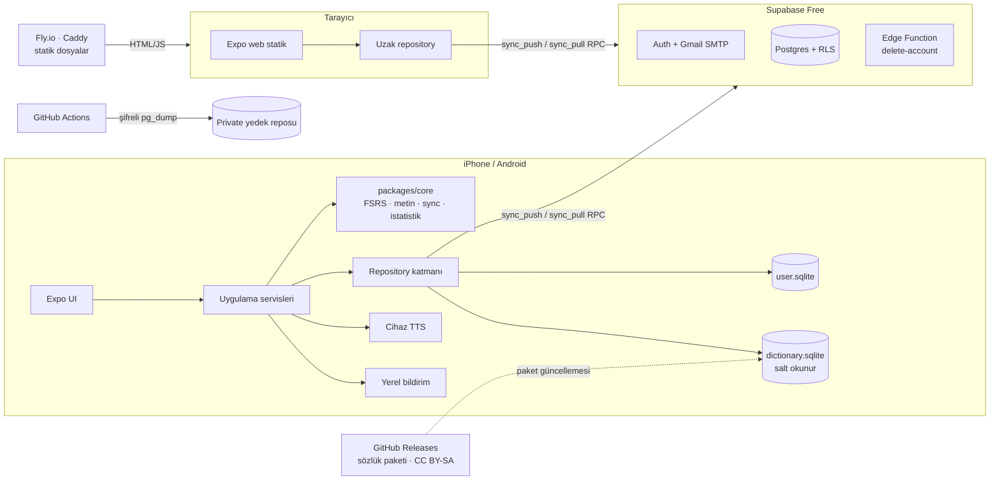
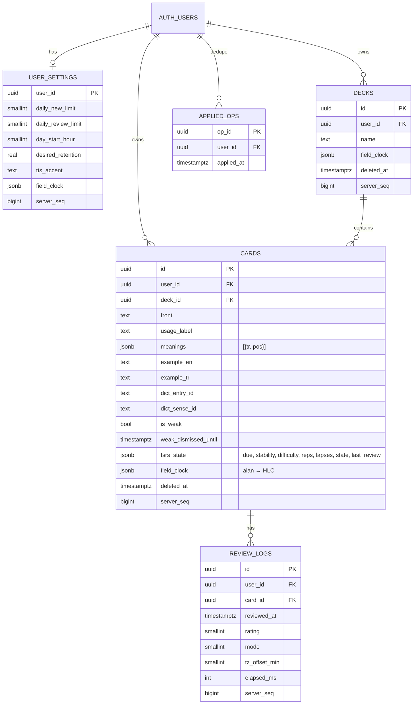

# DilKart teknik planı

Onay: 24 Eki 2026. Girdi: [prompt-v2.md](prompt-v2.md).
Doğrulanmış bulgu = kaynaklı; **[V]** = uygulama öncesi doğrulanacak varsayım.

Seçilen ad: **dilkart**. Kod lisansı: MIT. Sözlük paketi: CC BY-SA 4.0.

## 1. Yönetici özeti ve MVP kapsamı

- **Mimari:** Tek Expo (React Native + TypeScript) uygulaması iOS, Android ve
  statik web çıktısı üretir. Kullanıcı verisi cihazda SQLite'ta, sözlük ayrı
  salt okunur SQLite paketinde. Supabase (Free) yalnızca Auth + Postgres + tek
  Edge Function. Fly.io yalnızca web'in statik dosyalarını sunar. Kendi
  backend API'miz yok.
- **Sözlük:** Tamamen açık lisanslı kaynaklardan derlenen, uygulamayla gelen
  çevrimdışı paket: Vikisözlük (EN→TR), İngilizce Vikisözlük (TR→EN +
  çeviri tabloları), Open English WordNet (EN→EN), Tatoeba (örnek cümle).
  Üç yön karşılanıyor görünüyor; kapsam ve boyut PoC'de ölçülecek.
- **Tekrar:** FSRS (ts-fsrs, MIT), cihazda çalışır; tekrar geçmişi
  yalnızca eklenen (append-only) kayıtlar → senkronizasyonda çakışma yok.
- **Senkronizasyon:** Kendi yazdığımız, Postgres RPC tabanlı; alan bazlı
  birleştirme. Hazır sync servisleri ücretsiz plan/bağımlılık nedeniyle elendi.
- **Risk önce:** İki PoC (sözlük, senkronizasyon) uygulamanın geri kalanından
  önce ölçülür; sonuçlara göre devam/dur kararı senindir.

**MVP (TestFlight):** misafir modu; deste/kart CRUD (çevrimdışı); 5 çalışma
modu; TTS; üç yönlü çevrimdışı sözlük paneli; son aramalar; tek butonla
sözlükten karta; zayıf kelimeler (işaretleme + öneri); istatistikler;
ayarlar; yerel hatırlatmalar; e-posta+parola hesabı (OTP kodla doğrulama ve
parola sıfırlama); misafir verisinin hesaba bağlanması; senkronizasyon;
web'de giriş + deste/kart yönetimi + hesap silme + veri dışa aktarma.

**MVP dışı (sonraki sürüm):** App Store yayını (alan adı + işlem e-postası),
Android mağaza yayını, web'de çalışma/sözlük/istatistik, çakışma geçmişi
arayüzü, CAPTCHA (App Store öncesi), bölüm 10B listesi.

## 2. Gereksinimler, varsayımlar, kapsam dışı

| Tür | Madde |
|---|---|
| Zorunlu | Kartlar ve üç yönlü sözlük tam çevrimdışı; misafir modu; hesap silme (Apple 5.1.1(v)); istemcide gizli anahtar yok; RLS ile kullanıcı izolasyonu |
| Ölçek | ≤100 TestFlight kullanıcısı; kullanıcı başına ≤20.000 kart, ≤500.000 tekrar kaydı, 1–3 cihaz |
| Varsayım | Arayüz Türkçe (i18n hazır); iPhone öncelikli; karanlık mod, Dynamic Type, VoiceOver temel; minimum iOS = Expo SDK'nın desteklediği alt sınır **[V]** |
| Varsayım | Kart = tek kelime/ifade (ön yüz) + 1..n anlam (arka yüz); farklı kullanımlar için ayrı kart + isteğe bağlı kullanım etiketi ("bank · finans") |
| Varsayım | Örnek cümlenin Türkçe çevirisi isteğe bağlı alan (Tatoeba'dan gelirse dolu); kart şablonu özelleştirme yok (maliyet > fayda) |
| Varsayım | Son aramalar cihaza özel (gizlilik + gereksiz sync yok); zayıf işareti ve çalışma ayarları senkronize; bildirim ayarları cihaza özel |
| Kapsam dışı | Prompt 10B listesi (Anki/CSV, görsel, paylaşım, sosyal, AI, ödeme, push, IPA, boşluk doldurma, karıştırılanlar, favoriler) |

## 3. Mimari diyagram



Katmanlar: UI → servisler (use-case) → repository → sürücü (expo-sqlite,
supabase-js). UI hiçbir zaman sürücüye doğrudan gitmez.

## 4. Teknoloji kararları

| Konu | Karar | Neden | Elenen |
|---|---|---|---|
| Mobil | **React Native + Expo + TS** (kalıyor) | Tek kod tabanından web çıktısı; ts-fsrs ve Supabase Edge Functions (Deno/TS) ile aynı dil; expo-sqlite FTS5 varsayılan açık; expo-speech; yerel bildirim | Flutter (web çıktısı canvas tabanlı ve ağır, Dart ayrı dil); native Swift+Kotlin (iki kod tabanı); KMP (UI yine iki kez) |
| Web | **Expo Router web, `web.output: "static"`** | Ayrı framework yok; domain kodu ve bileşenler paylaşılır; `npx expo export -p web` → `dist/` | Next.js static export: daha iyi web DX ama ikinci framework, kart düzenleme ekranları iki kez yazılır |
| Yerel DB | **expo-sqlite**; kullanıcı verisi şeması ve migration'ları `core` `LocalStore`'da (ADR 0009), sözlük düz expo-sqlite | FTS5 config plugin ile varsayılan açık; tüm yazmalar outbox'tan geçer | WatermelonDB (JSI kurulumu, kendi sync protokolü yine backend ister); Drizzle (outbox'ı atlayan yazma yolu, kod üretimi; ADR 0009) |
| Senkronizasyon | **Kendi sync'imiz: Postgres RPC** (`sync_push`, `sync_pull`) | Ücretsiz, ek servis/hesap yok, tamamen test edilebilir | PowerSync Free: 7 gün bağlantısız kalan instance kaldırılıyor, 2 GB/ay; self-host Fly'da 5$'ı aşar. ElectricSQL: ayrı servis + replikasyon, maliyet |
| Algoritma | **FSRS (ts-fsrs, MIT, FSRS-6)**, cihazda | Daha az tekrarla aynı hatırlama; parametrelenebilir hedef hatırlama oranı; deterministik → test ve yeniden hesaplama kolay | SM-2: basit ama sabit çarpanlar, kötü kart "ease hell" sorunu |
| TTS | **expo-speech (cihaz TTS)** | Ücretsiz, çevrimdışı (iOS'ta yüklü sesler), lisans sorunu yok | Bulut TTS (kart ister); Wiktionary ses dosyaları (20 GB, karışık lisans) |
| Bildirim | **expo-notifications, yalnızca yerel** | Hatırlatma için sunucu gerekmez | Sunucu push (altyapı, token yönetimi; MVP'de gereksiz) |
| Sunucu mantığı | **Tek Edge Function: `delete-account`** | service_role gerektiren tek iş; dışa aktarma RLS ile istemcide yapılır | Ayrı API servisi |
| Web barındırma | **Fly.io, Caddy ile statik**, `auto_stop_machines` | Senin tercihin; maliyet ≈0 | Taşınma yolu: aynı `dist/` → Cloudflare Pages / GitHub Pages |
| Sözlük build | **Python (uv) ETL betikleri** | Büyük JSONL işleme; backend/AI rotana uygun | Node (aynı dil ama veri işleme ekosistemi zayıf) |
| Mobil build | **EAS Build (Free: ayda 15 iOS)** + gerektiğinde `eas build --local` | TestFlight'a `eas submit`; kota yeterli | Yalnız Xcode (imza/upload el işi) |
| OTA | EAS Update (Free: 1.000 MAU) | Sadece JS düzeltmeleri; TestFlight'ta yeter | — |
| Hata gözlemi | **Yok** (26 Eki 2026) | İhtiyaç görülmedi | Sentry Developer |
| E2E | **Maestro** (açık kaynak CLI) | YAML akışları, iOS simülatör; public repoda macOS runner ücretsiz | Detox (kurulum ağır) |

## 5. Repo yapısı

```
<ad>/
  apps/app/                Expo: iOS, Android, Web
    app/                   Expo Router rotaları ((tabs), study, decks, settings, web'e özel auth rotaları)
    src/features/          study, decks, dictionary, weak, stats, settings, auth
    src/services/          use-case'ler (UI buraya konuşur)
    src/data/              repository arayüzleri + local (core LocalStore) + remote (Supabase)
    src/drivers/           expo-sqlite, supabase-js, expo-speech sarmalayıcıları
  packages/core/           saf TS, platformdan bağımsız: fsrs, text (normalize, answer), sync (HLC, merge), stats, weak
  tools/dictionary/        Python ETL → dictionary.sqlite + kapsam raporu
  supabase/                migrations/, seeds/ (sahte veri), tests/ (pgTAP), functions/delete-account/
  infra/web/               Dockerfile, Caddyfile ; fly.toml kökte
  docs/                    plan.md, decisions/ (ADR), privacy.md, kvkk.md
  .github/workflows/       ci.yml, e2e.yml, deploy-web.yml, dictionary-release.yml
```

pnpm workspace. `packages/core` React/Expo'ya bağımlı değil; mobil ve web onu
kullanır, birbirine bağlanmaz. Web ayrı uygulama değil: aynı app'in web
hedefi, web'de görünmeyecek rotalar `+not-found`/platform dosyasıyla kapatılır.

## 6. Veri modeli ve ER



- Kimlikler istemcide üretilir (UUIDv7: zamana göre sıralı, çevrimdışı çakışmaz).
- `server_seq`: Postgres sequence'tan, her insert/update'te trigger ile;
  cihaz saatine bağlı olmayan çekme imleci.
- `fsrs_state` türetilmiş bir önbellek: kaynak her zaman `review_logs`.
- `app_config` (min_app_version, min_schema_version): herkes okur, kimse yazmaz.
- Cihazda ayrıca: `outbox` (gönderilmemiş işlemler), `sync_cursor`,
  `recent_searches` (yalnız yerel), `device_settings` (bildirim).
- Sözlük ayrı dosya: `entries(id, lang, headword, key, pos)`,
  `senses(id, entry_id, gloss, lang_target, source)`, `examples`,
  `forms(form_key → entry_id)`, `relations(syn/ant)`, `meta(version, licenses)`.

## 7. Yerel veri ve senkronizasyon tasarımı

**Yazma yolu (çevrimdışı dahil):** Her değişiklik tek SQLite transaction'ında
(a) satırı günceller, (b) `outbox`'a `{op_id, table, row_id, changed_fields,
hlc}` ekler. Ağ durumundan bağımsız.

**Gönderme (`sync_push`):** Arka planda en fazla 500 işlemlik paketler. RPC
tek transaction'da çalışır; `op_id` `applied_ops`'ta varsa atlanır →
aynı paketin tekrar gönderilmesi güvenli (idempotent). Hata: üstel geri
çekilme (1 sn → 5 dk), paket bölünerek yeniden deneme; outbox ancak sunucu
onayıyla silinir → veri kaybı yok.

**Çekme (`sync_pull(since_seq)`):** Tablo başına `server_seq > imleç` sırayla,
1.000'lik sayfalar. İlk senkronizasyon aynı yol, sayfalı; arayüz kilitlenmez.

**Çakışma politikası (tür bazında):**

| Veri | Yöntem | Gerekçe |
|---|---|---|
| Tekrar geçmişi | Yalnız ekleme, birleşim (union) | Çakışma oluşamaz; iki cihazdaki tekrarlar kaybolmaz |
| Kart FSRS durumu | Yeni log gelince o kartın logları `reviewed_at` sırasıyla yeniden oynatılır | Deterministik; hangi cihaz önce gönderirse göndersin aynı sonuç |
| Kart içeriği (front, meanings, örnekler, deck_id, is_weak) | **Alan bazlı LWW + HLC** (Hybrid Logical Clock: cihaz saati sapsa da sıralamayı koruyan saat) | Web'de anlam, mobilde deste değişirse ikisi de korunur; yalnız aynı alan aynı anda değişirse biri kazanır |
| Aynı alanın eşzamanlı değişimi | Kaybeden değer `card_conflicts` tablosuna yazılır (MVP'de arayüzsüz, sonra "diğer sürümü göster") | Sessiz veri kaybı yok |
| Silme | Tombstone (`deleted_at`); silme eşzamanlı düzenlemeye üstün gelir | Basit ve öngörülebilir; 30 gün sonra sunucuda kalıcı temizlik |
| Ayarlar | Alan bazlı LWW | Düşük risk |

Değerlendirilen alternatifler: satır bazlı LWW (bir cihazın değişikliği
diğerini tamamen ezer → elendi), elle çözüm ekranı (her çakışmada kullanıcıyı
yorar → yalnızca kayıt), CRDT/Automerge (kart alanları kısa metin; maliyet >
fayda).

**Misafir → hesap:** Misafir verisi yalnız cihazda (Supabase anonim kullanıcı
açılmaz: çevrimdışı çalışmaz, MAU ve kötüye kullanım yükü). Kayıt/girişte:
hesap boşsa tüm yerel veri outbox'a alınıp yüklenir; hesapta veri varsa
kullanıcıya "Bu cihazdaki X kartı hesabına ekle / bırak" sorulur, eklenirse
aynı ad + aynı normalize ön yüz mükerrer olarak işaretlenir.

**Çıkış / başka hesap:** Kullanıcı başına ayrı `user_<uid>.sqlite`. Çıkışta
outbox boş değilse uyarı; çıkışta dosya silinir. Sözlük paketi kalır.

**Şema ve sürüm uyumu:** Sunucu migration'ları geriye uyumlu eklenir (önce
yeni kolon, sonra istemci, en son eski kolonun kaldırılması). `sync_push`
istemci şema sürümünü alır; `app_config.min_schema_version` altındaysa
reddeder → uygulama "güncelleme gerekli" gösterir, veri cihazda kalır.

**Supabase duraklatılırsa:** Sync hatası sessizce geri çekilir, uygulama
tamamen çalışmaya devam eder, ayarlarda "Son senkronizasyon: ..." görünür.

## 8. Çevrimdışı özellik matrisi

| Özellik | Durum | Not |
|---|---|---|
| Deste/kart oluşturma, düzenleme, taşıma, silme | Tam | Zorunlu |
| Üç yönlü sözlük, sözlükten karta | Tam | Zorunlu; paket cihazda |
| Modül 1–3 (anlam hatırlama, ters, yazma) | Tam | Ek maliyet yok |
| Modül 4 (dinleyip yazma) | Kısmen | iOS'ta yüklü İngilizce ses çevrimdışı; Android'de ses paketi yoksa kapalı + uyarı |
| Modül 5 (eşleştirme) | Tam | Ek maliyet yok |
| Kelimeyi sesli dinleme | Kısmen | Modül 4 ile aynı kısıt |
| Son aramalar, zayıf kelimeler, ayarlar | Tam | Yerel |
| İstatistikler | Kısmen | Cihazdaki loglarla tam; diğer cihazın tekrarları sync sonrası |
| Hatırlatmalar | Tam | Yerel bildirim |
| Kayıt, giriş, doğrulama, parola sıfırlama, hesap silme | Çevrimiçi gerekli | Supabase Auth |
| Senkronizasyon, sözlük paketi güncellemesi | Çevrimiçi gerekli | — |
| Web'in tamamı | Çevrimiçi gerekli | Gereksinim yok |

Öneri: zorunlu olmayan modüllerin hepsi tam çevrimdışı olsun; ek maliyetleri
sıfır, tek istisna cihaz sesine bağlı TTS.

## 9. Sözlük kaynakları ve lisans fizibilitesi

| Kaynak | Yön | Kapsam (doğrulanmış) | Lisans | Kullanım |
|---|---|---|---|---|
| Vikisözlük (tr.wiktionary) via kaikki/wiktextract | EN→TR, TR→TR | İngilizce: 120.208 anlam; Türkçe: 392.996 anlam (dump 2026-10-02); JSONL 707,7 MB (43,8 MB gz) | CC BY-SA 4.0 + GFDL | Ana EN→TR kaynağı |
| İngilizce Vikisözlük via kaikki | TR→EN, EN→TR (çeviri tabloları), çekim formları | Türkçe: 42.452 kelime, ~60.762 anlam; İngilizce: 1.396.111 kelime/form (dump 2026-10-01); ham JSONL 2,9 GB gz | CC BY-SA 4.0 + GFDL | TR→EN; `went→go`, `kitaplar→kitap` form tabloları |
| Open English WordNet 2025 | EN→EN, eş/zıt anlam, sözcük türü, örnek | 2025 sürümü, JSON 9,5 MB zip | CC BY 4.0 **[V: LICENSE dosyası]** | EN→EN tanımlar |
| Tatoeba | Örnek cümle EN↔TR | Çiftler "sentence pairs" dışa aktarımı; sayı **[V]** | CC BY 2.0 FR (bir kısmı CC0) | Kart ve sözlük örnek cümleleri |
| FreeDict eng-tur / tur-eng | — | tur-eng 1.026 başlık ("too small") | GPL | **Elendi**: küçük + GPL/App Store riski |
| Ticari sözlükler (Tureng, Cambridge, Oxford) | — | — | Kapalı | **Elendi**: lisans yok |
| Oxford 3000 vb. listeler | — | — | Telif | **Elendi**; sıklık için açık lisanslı liste **[V: wordfreq verisinin lisansı]** |

**Üç yön değerlendirmesi:** EN→TR (Vikisözlük + EN Vikisözlük çevirileri),
TR→EN (EN Vikisözlük Türkçe girdileri + çevirilerin tersi), EN→EN (OEWN).
Kâğıt üstünde karşılanıyor; **risk Türkçe karşılıkların kalitesi ve sık
kelimelerdeki kapsamı**. PoC kabul eşiği: en sık 10.000 İngilizce lemmanın
≥%90'ında en az bir Türkçe karşılık; en sık 5.000 Türkçe lemmanın ≥%85'inde
İngilizce karşılık; her sözlük girdisinin ≥%60'ında örnek cümle. Eşik
tutmazsa senden karar istenir (kaynak ekleme / kapsamı daraltma).

**Lisans sonuçları:**
- CC BY-SA "share-alike" yalnızca **derlenen sözlük veritabanını** bağlar,
  uygulama kodunu bağlamaz. Paket CC BY-SA 4.0 ile yayınlanır.
- CC BY-SA 4.0, alıcının haklarını kısıtlayan DRM'i yasaklar; App Store'un
  şifrelemesi buna takılabilir. Önlem: aynı paket GitHub Releases'te herkese
  açık ve ücretsiz indirilebilir tutulur (barındırma sorunu da çözülür).
  **[V: hukuki kesinlik yok; yaygın uygulama bu]**
- Uygulamada "Lisanslar ve atıflar" ekranı: kaynak adı, lisans, bağlantı,
  paket sürümü; kaikki/wiktextract atfı.

**Dağıtım:** Önce tüm paket uygulamayla gelir (tahmin 40–90 MB, ölçülecek);
200 MB hücresel sınırının altında. PoC 150 MB'ı aşarsa: çekirdek paket (en
sık 20k EN + 20k TR lemma, tüm anlamları) gömülü, tam paket isteğe bağlı
indirme (GitHub Releases, SHA-256 doğrulama). Güncellemeler sürümlü paket;
girdi/anlam kimlikleri kaynak sayfa adı + sözcük türü + anlam sırasından
kararlı üretilir, kartlar bu kimliği saklar → güncelleme kartı bozmaz.

**Arama:** Build sırasında her başlık için normalize anahtar (bölüm 4A)
üretilir; arama `key` üzerinde B-tree önek araması (`key >= ? AND key < ?`),
bulunamazsa `forms` tablosundan lemmaya yönlendirme; EN→EN tanım içi arama
FTS5. Deyim/phrasal verb'ler ayrı başlık olarak gelir ("give up").

## 10. Kimlik doğrulama, RLS ve güvenlik

**Auth akışları (link yerine 6 haneli kod):**
- Kayıt: `signUp(email, password)` → e-postada kod (`{{ .Token }}`) →
  `verifyOtp` → hesap aktif. **[V: SDK sürümünde doğru `type`]**
- Parola sıfırlama: `resetPasswordForEmail` → kod → `verifyOtp(type:
  'recovery')` → `updateUser({password})`.
- Neden kod: universal link, alan adı ve `apple-app-site-association`
  gerektirmez; telefonda okunan kod web'e de girilebilir.
- SMTP: uygulamaya özel yeni Gmail + app password (2 adımlı doğrulama şart).
  Sınır: kişisel Gmail ~500 alıcı/gün **[V: Google resmî sayfası]**; Auth
  rate limit 30/saat'e ayarlanır. Risk: Google otomatik gönderimi kısıtlayabilir
  → App Store öncesi alan adı + işlem e-postası.
- CAPTCHA: TestFlight'ta yok (davetli kullanıcılar); App Store öncesi
  Cloudflare Turnstile (Supabase destekliyor, ücretsiz).

**RLS matrisi** (tüm tablolarda `FORCE ROW LEVEL SECURITY`; `anon` rolü
yalnız `app_config` okur):

| Tablo | select | insert | update | delete |
|---|---|---|---|---|
| user_settings | kendi | kendi (`user_id = auth.uid()`) | kendi | yok |
| decks, cards | kendi | kendi | kendi (yalnız RPC üzerinden) | yok (tombstone) |
| review_logs | kendi | kendi | yok | yok |
| applied_ops, card_conflicts | kendi | kendi (RPC) | yok | yok |
| app_config | herkes | yok | yok | yok |

- RPC'ler `SECURITY INVOKER` → RLS içeride de geçerli; `user_id` istemciden
  alınmaz, `auth.uid()`'den yazılır.
- Kalıcı silme yalnız `delete-account` Edge Function'da: JWT doğrulanır,
  `auth.admin.deleteUser(uid)`; tüm tablolar `ON DELETE CASCADE`.
- Veri dışa aktarma: istemci kendi verisini JSON olarak indirir (RLS yeter,
  sunucu kodu yok).
- Sırlar: istemcide yalnız Supabase URL + publishable key. `service_role`
  yalnız Supabase'in Edge Function ortamında. GitHub secrets: `FLY_API_TOKEN`
  (uygulamaya kısıtlı deploy token), yedek reposunda DB bağlantı dizesi.
  Repoda `.env.example` dışında env dosyası yok; push protection + gitleaks.

## 11. Fly.io, Docker ve dağıtım

- **Fly'da çalışan tek şey:** Caddy (`caddy:2-alpine`) ile `dist/`.
  Dockerfile çok aşamalı: Node aşaması `expo export -p web`, Caddy aşaması
  dosyaları sunar; SPA fallback, `/healthz` statik dosyası, gzip/zstd,
  güvenlik başlıkları (CSP, HSTS).
- **fly.toml:** `shared-cpu-1x`, 256 MB, `auto_stop_machines = "stop"`,
  `auto_start_machines = true`, `min_machines_running = 0`, HTTP health check
  `/healthz`, paylaşımlı IPv4 (ayrı IPv4 2$/ay → alınmaz), tek bölge `fra`/`ams`.
- **Env/secret:** Supabase URL ve publishable key build argümanı (public);
  Fly secret gerekmiyor.
- **Dağıtım:** `main`'e merge → CI yeşil → `flyctl deploy --remote-only`
  (GitHub Actions). Geri dönüş: `fly releases` + önceki imaj.
- **Log/gözlem:** `fly logs`; uygulama hata takibi yok (bölüm 16, madde 2).
- **Mobil ayrı hat:** EAS Build → `eas submit` → TestFlight. `appVersion`
  semver, build numarası EAS tarafından artırılır. JS düzeltmeleri EAS Update.
- **Taşınma yolu:** Fly muafiyeti biterse aynı `dist/` Cloudflare Pages'e;
  yalnız `deploy-web.yml` değişir.

**Ücretsiz plan tüketim tablosu (TestFlight, 100 kullanıcı):**

| Kaynak | Sınır | Tahmin | Durum |
|---|---|---|---|
| Fly makine | 5$/ay muafiyet **[V: yeni hesapta]** | 256 MB = 0,0028$/saat çalışırken; düşük trafikle <0,5$/ay; durdurulmuşken rootfs 0,15$/GB/ay ≈ 0,01$ | Rahat |
| Supabase DB | 500 MB | Ortalama kullanıcı (1k kart, 10k log) ≈ 1,5 MB → 150 MB | Rahat; **ağır kullanıcı (20k kart, 500k log) ≈ 100 MB → 5 ağır kullanıcı sınırı zorlar** |
| Supabase egress | 5 GB/ay | Delta sync KB düzeyinde; sözlük Supabase'ten indirilmez | Rahat |
| Supabase Auth MAU | 50k | ≤100 | Rahat |
| Edge Function | 500k çağrı/ay | Yalnız hesap silme | Rahat |
| EAS Build | 15 iOS/ay | Haftada 1–2 TestFlight | Rahat |
| EAS Update | 1.000 MAU | ≤100 | Rahat |
| GitHub Actions | Public repoda sınırsız; private yedek reposu 2.000 dk + 500 MB | Haftalık yedek ~2 dk, dump ≤50 MB × 8 hafta | Rahat |
| Gmail | ~500/gün **[V]** | Kayıt + sıfırlama, günde <20 | Rahat |
| Supabase pause | 7 gün düşük aktivite | Geliştirme yerelde; prod'da gerçek kullanıcı aktivitesi | Kabul edilebilir risk |

Kota önlemi: kullanıcı başına 20.000 kart sınırı RPC'de; DB boyutu haftalık
CI raporunda.

## 12. Test stratejisi ve kabul kriterleri

Her iş önce başarısız test, sonra kod (TDD). Katmanlar:
- `packages/core`: Vitest (saf TS, hızlı, CI'da her push).
- `apps/app`: jest-expo + React Native Testing Library (ekran/servis).
- Supabase: `supabase start` (Docker) + pgTAP (`supabase test db`) — RLS ve RPC.
- Sync: iki sanal istemcili Vitest harness (gerçek yerel Supabase'e karşı).
- E2E: Maestro, iOS simülatör; "çevrimdışı" = yerel Supabase durdurulur.
- Gerçek cihaz (elle, kontrol listesiyle): TTS sesleri, bildirim zamanlaması,
  sözlük arama süresi.

| Alan | Kabul kriteri (ölçülebilir) |
|---|---|
| Kart CRUD + deste taşıma | Oluştur/düzenle/taşı/sil sonrası uygulama kapatılıp açılınca durum aynı; 1.000 kartlı destede liste açılışı ≤300 ms |
| Üç yönlü arama | 300 sorguluk altın küme (her yön 100): ilk 3 sonuçta doğru girdi ≥%95; p95 ≤100 ms (iPhone 12 sınıfı) |
| Metin işleme (4A) | ≥80 vakalık tablo testi %100: `I→ı`, `İ→i`, `sogan→soğan`, `went→go`, `kitaplarım→kitap`, `give up`; yazım toleransı: ≤6 harfte 1, >6 harfte 2 düzenleme mesafesi "neredeyse doğru" |
| Sözlükten tek butonla kart | Tek dokunuş → kart son kullanılan destede, ön yüz = başlık, arka yüz = seçilen anlam + örnek; aynı anlamda ikinci dokunuş mükerrer uyarısı verir, kart oluşturmaz |
| Çevrimdışı + yeniden başlatma | Uçak modunda 100 değişiklik, uygulama zorla kapatılıp açılır → 100'ü de yerelde; bağlantı gelince ≤60 sn içinde 100'ü sunucuda, kopya yok |
| Idempotency | Aynı push paketi 5 kez gönderilince sunucuda tek kayıt |
| Çakışma | Web'de anlam + mobilde deste değişimi → ikisi korunur; aynı alanın eşzamanlı değişimi → HLC'si büyük kazanır, diğeri `card_conflicts`'ta |
| Tekrar geçmişi | İki cihazda çevrimdışı tekrar → birleşim sonrası log sayısı = toplam; FSRS durumu her iki cihazda bit düzeyinde aynı |
| FSRS doğruluğu | ts-fsrs referans değerleriyle karşılaştırmalı test; gün başlangıcı 04:00 ve saat dilimi değişimi vakaları |
| Zayıf kelime + istatistik | Kurallar sabit log fikstürleriyle; tek yanlış cevap öneri üretmez (test), eşik vakaları ±1 sınır testli |
| Misafir → hesap | Misafir 50 kartla kayıt → sunucuda 50 kart, kimlikler aynı; dolu hesaba girişte soru ekranı çıkar |
| İlk sync | 5.000 kart + 50.000 log ≤30 sn, arayüz kilitlenmeden |
| TTS | iOS + Android emülatörde ses yoksa uyarı gösterilir, çökme yok; aksan ayarı uygulanır |
| Bildirim | Kapatınca planlı bildirim sayısı 0; saat değişince yeniden planlanır |
| E-posta doğrulama / sıfırlama | Yerel Mailpit'te kod gelir, doğru kod → giriş; yanlış/eski kod → hata mesajı; 60 sn yeniden gönderme sınırı |
| RLS izolasyonu | pgTAP: A kullanıcısı B'nin satırını okuyamaz/değiştiremez, sahte `user_id` ile insert reddedilir, anon yalnız `app_config` okur — tüm tablolar için |
| Web → mobil | Web'de düzenlenen kart, mobilde ön plana gelince ≤10 sn içinde görünür |
| Hesap silme / dışa aktarma | Silme sonrası kullanıcıya ait satır sayısı 0 (tüm tablolar); dışa aktarma JSON'u tüm kart + logları içerir |
| Gizli anahtarlar | gitleaks CI'da temiz; build çıktısında `service_role`/`sb_secret_` araması 0 sonuç |
| Yedekten dönüş | Ayda bir: şifreli dump yerel Supabase'e geri yüklenir, satır sayıları eşleşir |
| Performans | Soğuk açılış ≤2 sn |

## 13. Aşamalı geliştirme planı

Her aşama sonunda: testler yeşil → commit + push (isim onayından sonra
beklemeden). Hesap gereken aşamadan önce senden yeni hesap açman istenir.

Durum (28 Eki 2026): Aşama 0–7 bitti; Aşama 8'de Ayarlar, zayıf kelimeler ve istatistikler bitti.
Sıradaki: hatırlatma bildirimi.

| # | Aşama | Amaç / işler | Bağımlılık | Bitti sayılır |
|---|---|---|---|---|
| 0 | İskele | İsim onayı → `~/Desktop/<ad>`, public repo, pnpm workspace, Expo app, `packages/core`, CI (lint, tsc, Vitest, gitleaks), `docs/plan.md` + ilk ADR'ler | İsim, Expo hesabı **(karar)** | CI yeşil, boş app simülatörde açılır |
| 1 | **PoC-A Sözlük** | Python ETL: kaikki (tr + en), OEWN, Tatoeba → `dictionary.sqlite`; kapsam raporu; Expo dev build'de arama ölçümü (gerçek iPhone) | 0 | Boyut, kapsam (bölüm 9 eşikleri), p95 ölçüldü ve rapor `docs/` altında |
| 2 | **PoC-B Sync** | Yerel Supabase: şema, RLS, `sync_push/pull`, HLC; iki istemcili harness: çevrimdışı, idempotency, çakışma, misafir bağlama, 50k log ilk sync | 0 | Bölüm 12 sync kriterleri yerelde geçer |
| — | **Karar kapısı** | PoC sonuçlarıyla devam/değişiklik kararı | 1, 2 | Senin onayın |
| 3 | Core domain | Kart modeli, FSRS sarmalayıcı, 4A metin işleme, cevap kontrolü, zayıf öneri kuralı, istatistik hesapları | Kapı | Bölüm 12'deki core kriter tabloları geçer |
| 4 | Yerel uygulama | LocalStore migration'ları + sorgular (ADR 0009), repository katmanı, deste/kart CRUD, misafir modu | 3 | Çevrimdışı CRUD kriterleri |
| 5 | Çalışma | Modül 1–5, oturum akışı, günlük limitler, TTS + aksan | 4 | Çalışma ve TTS kriterleri |
| 6 | Sözlük paneli | Alt panel (çalışma durumu korunur), üç yön, son aramalar, tek butonla kart, mükerrer uyarısı, lisans ekranı | 1, 4 | Arama + tek buton kriterleri |
| 7 | Hesap + sync | **Supabase `dilkart` org + prod projesi** (mevcut hesap, Free), Gmail SMTP, OTP akışları, misafir bağlama, sync servisi, çıkış | 2, 4 | Auth + sync kriterleri (prod'a karşı duman testi) |
| 8 | Kişiselleştirme | Zayıf kelimeler, istatistik ekranı, ayarlar, yerel hatırlatmalar | 5 | İlgili kriterler |
| 9 | Web | Web rotaları: auth, deste/kart yönetimi, hesap silme, dışa aktarma; **yeni Fly.io hesabı**, Dockerfile, deploy workflow | 7 | Web → mobil kriteri, Fly'da canlı |
| 10 | Güvenlik ve operasyon | pgTAP tam set, `delete-account`, private yedek reposu + geri yükleme provası, Maestro E2E | 7, 9 | Güvenlik + yedek kriterleri |
| 11 | TestFlight | Gizlilik politikası + KVKK sayfası (web), App Privacy beyanı, Beta App Review, demo hesap | 10 | İlk harici TestFlight build'i yayında |
| 12 | Sonra | App Store (alan adı, işlem e-postası, Turnstile), Android mağaza kararı | 11 | — |

## 14. Riskler

| Risk | Tür | Etki | Önlem |
|---|---|---|---|
| Vikisözlük Türkçe karşılık kalitesi/kapsamı yetersiz | Ürün | Yüksek | PoC-A eşikleri; ek açık kaynak; eşik tutmazsa kapsam kararı |
| CC BY-SA + App Store DRM uyumu | Yasal | Orta | Paketi GitHub'da açık yayınlama; atıf ekranı |
| Kendi sync kodumuzda hata → veri kaybı | Teknik | Yüksek | Append-only loglar, outbox onaysız silinmez, PoC-B harness, yedek |
| Fly 5$ muafiyeti yeni hesapta yok/sona erer | Maliyet | Düşük | Statik çıktı; Cloudflare Pages'e taşıma |
| Gmail SMTP kısıtlanır | Teknik | Orta | Düşük hacim; App Store öncesi alan adı |
| Supabase 500 MB'ı ağır kullanıcılar doldurur | Maliyet | Orta | Kart kotası, boyut raporu, log sıkıştırma |
| Supabase pause | Operasyon | Düşük | Çevrimdışı öncelikli tasarım; dashboard'dan geri açma |
| Free planda otomatik yedek yok | Operasyon | Yüksek | Haftalık şifreli pg_dump (pooler session mode, IPv4) |
| Android'de çevrimdışı TTS sesi yok | Ürün | Düşük | Algılama + uyarı |
| Expo SDK yükseltmeleri | Teknik | Orta | SDK sabitlenir, yılda 1–2 planlı yükseltme |
| Yanlış cihaz saati | Teknik | Düşük | HLC + `server_seq` |
| Public repoda sır sızıntısı | Güvenlik | Yüksek | Push protection, gitleaks, sırlar yalnız GitHub/Supabase secret'larında |
| Lisanssız public repo herkese "tüm hakları saklı" demektir | Yasal | Düşük | Lisans kararı (bölüm 16) |

## 15. İsim önerileri

Kontroller 24 Eki 2026: GitHub `ismailcelik-tr/<ad>` (404 = boş), App Store TR
araması (iTunes Search API).

| Ad | Anlam / neden | GitHub | App Store TR | Bundle ID |
|---|---|---|---|---|
| **dilkart** ⭐ | "Dil" + "kart": ne yaptığını söylüyor, kısa, ASCII → dizin, repo ve görünen ad birebir aynı | Boş | 0 sonuç | `com.ismailcelik.dilkart` |
| derkenar | "Kenar notu" (Osmanlıca): çalışırken yanda açılan sözlüğe gönderme, akılda kalıcı | Boş | 0 sonuç | `com.ismailcelik.derkenar` |
| sozkart | "Söz" + "kart"; görünen ad "Sözkart", repo ASCII | Boş | 0 sonuç | `com.ismailcelik.sozkart` |
| lexikart | "Lexicon" + "kart"; uluslararası, İngilizce öğrenmeyi çağrıştırır | Boş | 0 sonuç | `com.ismailcelik.lexikart` |
| ezberkart | Türk kullanıcıya tanıdık; "ezber" kavramı aralıklı tekrarın amacıyla tam örtüşmüyor | Boş | 0 sonuç | `com.ismailcelik.ezberkart` |

Elenenler: Aklımda, Lügat, Kelime Defteri, Hatırla, Kartlık, Bellek, Glossa,
Kelimo (App Store'da aynı/benzer adlı uygulamalar var); Kelimelik (popüler
kelime oyunu).

**Tercih: `dilkart`** — App Store adı "DilKart: İngilizce Kelime" (25 karakter).
Marka tescili kontrol edilmedi **[V]**.

## 16. Senden karar/onay bekleyenler (öncelik sırasıyla)

1. ~~İsim~~ → **dilkart** (24 Eki).
2. ~~Expo / Sentry hesabı~~ → Expo: mevcut hesap (`eas login` EAS gerektiğinde);
   Sentry: kullanılmıyor (26 Eki 2026).
3. ~~Kod lisansı~~ → **MIT**. Sözlük paketi CC BY-SA 4.0.
Karar kapısı 25 Eki 2026'da geçildi (4–11 onaylandı):

4. ~~PoC sonrası karar kapısı~~ → **devam**, plan değişmedi; FSRS'in loglardan
   yeniden oynatılması Aşama 3'e (`docs/poc-b-sync.md`).
5. ~~Zamanlamayı ne etkiler~~ → "tekrar oturumu" seçilen modla (1–4) kartın
   tek FSRS durumunu günceller (modül 1–2: kullanıcı Again/Hard/Good/Easy;
   yazma/dinleme: yanlış→Again, neredeyse→Hard, doğru→Good); modül 5 ve
   serbest çalışma yalnız pratik. Vadesi gelmemiş kart aynı gün yeniden
   çalışılırsa pratik sayılır.
6. ~~Web kapsamı~~ → MVP'de giriş + deste/kart yönetimi + hesap silme +
   dışa aktarma; çalışma, sözlük, istatistik sonra.
7. ~~Çakışma politikası~~ → alan bazlı LWW + HLC + çakışma kaydı (bölüm 7),
   PoC-B ile doğrulandı.
8. ~~Zayıf kelime öneri eşiği~~ → son 30 günde ≥2 unutma (lapse) ve son 8
   tekrarda ≥%40 hata, ya da art arda ≥3 hata; reddedilen öneri 14 gün
   tekrar gösterilmez; zayıf kelime oturumu pratik sayılır.
9. ~~Supabase pause~~ → yapay "canlı tutma" isteği yok, duraklarsa
   dashboard'dan açılır.
10. ~~Son aramalar~~ → cihaza özel.
11. ~~Sözlükten tek buton~~ → buton anlam satırında (o anlam karta gelir);
    hedef deste son kullanılan, uzun basınca deste seçimi.
12. Sonraya (Aşama 12'de sorulur): Google Play 25$, App Store için alan adı.

PoC'lerden aşamalara eklenenler (aynı gün onaylandı):

- **Aşama 3:** FSRS durumunun `review_logs`'tan yeniden oynatılması; iki
  cihazda bit düzeyinde aynı sonuç. Ayrıca: yazma modunda yalnız aksan farkı
  doğru sayılır (doğru yazım gösterilir); zayıf kural için "hata" = Again;
  istatistikler: günlük tekrar (30 gün), hatırlama oranı (7/30 gün), seri,
  kart durumları + 7 günlük vade tahmini.
- **Aşama 4:** kartlı deste silinince kartları da silinir (onayda kart sayısı); arayüz
  standart React Native bileşenleri + sistem görünümü; repository'ler `core/src/data`'da.
- **Aşama 5:** varsayılan limit 20 yeni / 200 tekrar; yeni kartlar tekrarların arasına
  dağıtılır; eşleştirme turu 6 çift (en az 4 kart); modül oturum başında seçilir (son seçim
  hatırlanır). `cards.fsrs_state` senkronize edilmez: cihazda loglardan türetilen önbellek.
  Öğrenme adımları (dakikalık) oturumda erken cevaplanırsa zamanlamaya sayılır (karar 5'e ek).
- **Aşama 6:** sözlük paketi uygulamaya gömülür (uygulama boyutu büyüyebilir); paket
  GitHub Releases'te `dictionary-v1` olarak yayınlanır, build öncesi SHA-256 ile indirilir;
  hiç deste yoksa sözlükten eklenen kart "Sözlükten" destesine gider.
- **Aşama 6:** sözlük eksikleri (`-ly` zarfları, `go` tür sırası, EN→EN
  işlev kelimeleri — önce boyut etkisi ölçülür).
- **Aşama 7:** kalıcı hata veren tek işlem `outbox_failed`'a taşınır, kuyruk
  sürer, ayarlarda sayısı görünür; cihaz saati sunucu `Date`'inden >1 gün
  ileriyse sync durur ve uyarı çıkar.
- **Aşama 7 (25 Eki):** Supabase mevcut hesapta `dilkart` Free org'u, proje
  `kcpwtkzhflsawtipjzcl` (Frankfurt). Misafir verisi dolu hesaba eklenirken aynı adlı desteler
  birleşir; aynı destede aynı kart (aynı sözlük anlamı ya da aynı ön yüz + kullanım etiketi)
  atlanır ve tekrar geçmişi hesaptaki karta aktarılır.
- **Aşama 7, cihaz testi (25 Eki):** sözlük dışındaki pencereler (yeni deste/kart, yeniden
  adlandır, taşı, misafir verisi) geri butonlu sayfa; sözlük alttan panel kalır. Ana sayfada
  açık/koyu görünüm anahtarı (cihaza özel, ilk kareden önce uygulanır); lisanslar "Hakkında"
  sayfasında. Jest React Compiler ile derler (Metro gibi). Günlük kullanım için telefona
  release build kurulur (`expo run:ios --configuration Release`); Expo Go geliştirmede kalır.
- **Aşama 8 (25 Eki):** ana sayfada "Hesap" altında Ayarlar sayfası; koyu görünüm anahtarı
  oraya taşınır. Zayıf kelimeler ana sayfanın üstünde şerit ("N zayıf kelime: Çalış / Gizle");
  istatistikler ayrı sayfa.
- **Aşama 8, Ayarlar (26 Eki):** limit, gün başlangıcı ve aksan `user_settings`'te (sync);
  ayarlar her kullanımda veritabanından okunur; misafir ayarları hesaba yalnız boş alanlara
  taşınır; gönderilemeyen değişiklik sayısı yalnız > 0 iken görünür. Ana sayfada çalış ve yeni
  deste üstte. Ayrıntı: `docs/superpowers/specs/2026-10-26-settings-design.md`.
- **Aşama 8, zayıf kelimeler (26 Eki):** öneriler kart kart onaylanır (✓ listesi); kabul anı
  `cards.weak_since`; art arda 3 doğruyla otomatik çıkış; "Gizle" yerine kart kart red (14 gün).
  Ayrıntı: `docs/superpowers/specs/2026-10-26-weak-words-design.md`.
- **Aşama 8, istatistikler (28 Eki):** tüm desteler toplamı, ayrı sayfa; ana sayfada seri satırı
  (seri = ≥1 cevaplı gün) ve günlük cevap hedefi (`user_settings.daily_goal`, varsayılan 50,
  ilerleme çubuğu). Grafikler düz `View`. Ayrıntı:
  `docs/superpowers/specs/2026-10-27-stats-design.md`.
- **Aşama 10:** tablolara doğrudan yazma kapatılır, sync RPC'leri
  `SECURITY DEFINER` (ADR 0008).
- **Aşama 11:** gömülü sözlük paketinin release build'de açılış süresi
  (soğuk açılış ≤2 sn).

## Doğrulama (uçtan uca)

- Her aşama: `pnpm lint && pnpm typecheck && pnpm test`; Supabase değişikliğinde
  `supabase test db`.
- PoC-A: `tools/dictionary` raporu + gerçek iPhone'da arama ölçümü.
- PoC-B: `pnpm test:sync` (iki istemcili harness, yerel Supabase).
- Aşama 7+: TestFlight build'inde manuel kontrol listesi (uçak modu, iki
  cihaz, web'de düzenleme).
- Aşama 10+: Maestro akışları CI'da; aylık yedek geri yükleme provası.

## Kaynaklar

- kaikki Türkçe (EN Vikisözlük): https://kaikki.org/dictionary/Turkish/index.html
- kaikki ham veri / Vikisözlük çıkarımı: https://kaikki.org/dictionary/rawdata.html , https://kaikki.org/trwiktionary/index.html
- Wikimedia lisans: https://meta.wikimedia.org/wiki/License
- Open English WordNet: https://en-word.net/downloads
- Tatoeba indirmeler: https://tatoeba.org/en/downloads
- FreeDict tur-eng: https://software.pureos.net/package/bin/pureos/amber/dict-freedict-tur-eng
- ts-fsrs: https://github.com/open-spaced-repetition/ts-fsrs
- expo-sqlite (enableFTS): https://docs.expo.dev/versions/v58.0.0/sdk/sqlite/
- Expo Router statik çıktı: https://docs.expo.dev/router/web/static-rendering/
- expo-speech: https://docs.expo.dev/versions/latest/sdk/speech/
- PowerSync fiyat: https://powersync.com/pricing
- Supabase fiyat / pause / SMTP / anonim giriş / OTP / IPv4:
  https://supabase.com/pricing , https://supabase.com/docs/guides/platform/free-project-pausing ,
  https://supabase.com/docs/guides/auth/auth-smtp , https://supabase.com/docs/guides/auth/auth-anonymous ,
  https://supabase.com/docs/reference/javascript/auth-verifyotp ,
  https://supabase.com/docs/guides/troubleshooting/supabase--your-network-ipv4-and-ipv6-compatibility-cHe3BP
- Fly.io fiyat / faturalama / deneme / 5$ muafiyeti:
  https://fly.io/docs/about/pricing/ , https://fly.io/docs/about/billing/ ,
  https://fly.io/docs/about/free-trial/ , https://community.fly.io/t/billing-for-small-applications/24434
- Expo fiyat: https://expo.dev/pricing
- Gmail SMTP sınırları (ikincil): https://developer.nylas.com/docs/cookbook/email/gmail-smtp-settings
